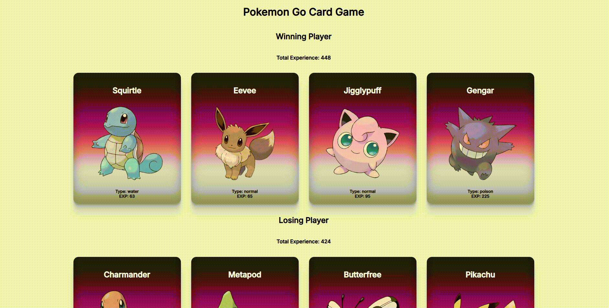

# 🎮 Pokemon Go Kart Oyunu

Bu proje, React kullanılarak geliştirilmiş interaktif bir Pokemon kart oyunudur. Oyunculara rastgele dağıtılan Pokemon kartları arasında toplam deneyim puanı üzerinden rekabet etme imkanı sunar.

📱 Ekran Görüntüsü

## ✨ Özellikler

- 🃏 Rastgele Pokemon kart dağıtımı
- ⚔️ İki oyunculu rekabet sistemi
- 🏆 Kazananı belirleyen otomatik skor hesaplama
- 🎨 Responsive ve modern tasarım
- 🔄 Canlı kart karıştırma
- 📱 Mobil uyumlu arayüz

🎯 Oyun Nasıl Oynanır?
Uygulama başladığında 8 farklı Pokemon kartı iki oyuncuya rastgele dağıtılır

Her oyuncunun kartlarındaki toplam deneyim puanı hesaplanır

Daha yüksek puana sahip oyuncu "Winning Player" olarak ilan edilir

Sayfa yenilendiğinde kartlar tekrar karıştırılır
